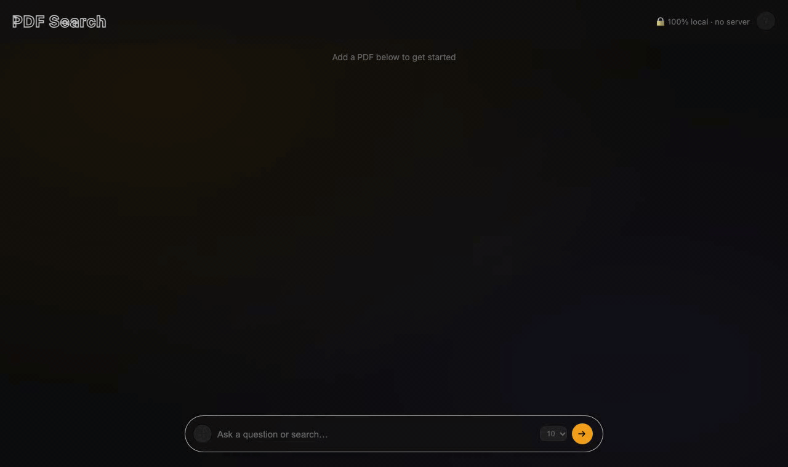

# In-Browser Semantic PDF Search

**Live:** https://pdf-search-79n.pages.dev

Search your own PDFs privately in the browser. No account, no server, no upload.
Text extraction, embedding, BM25, and hybrid retrieval all run on your device.
Results jump to the exact page and highlight the matching passage.



## How it works

1. Drop PDFs into the browser. PDF.js extracts text — no bytes leave your device.
2. Chunks are embedded with `all-MiniLM-L6-v2` (quantized, ~22 MB) running in a
   Web Worker via Transformers.js. The ONNX runtime loads from jsDelivr CDN on
   first use; the model weights load from Hugging Face CDN once and are cached
   by the browser. Documents themselves are never uploaded anywhere.
3. A BM25 index is built in parallel using Orama.
4. On query: dense retrieval + BM25 top-50 each, fused with RRF (2:1 dense:BM25),
   top-k results returned — verbatim passages from your documents, no generation.
5. Matched pages are rendered with PDF.js at 2× DPI and the matched passage is
   highlighted. Click any page to open the full PDF at that page.

Everything runs offline after the first load (model ~22 MB, cached by browser).

## Privacy

- PDFs are never uploaded. All processing is local.
- The embedding model is fetched once from Hugging Face CDN and cached by the browser.
- No analytics touch document content.
- Turn off Wi-Fi after the page loads — it still works.

## Known limits

| Limit | Detail |
|---|---|
| **500 pages total** | Across all loaded PDFs combined |
| **No OCR** | Scanned (image-only) PDFs return no text |
| **Two-column layouts** | Reading order issues in text extraction (affects most ML papers) |
| **Tables and equations** | Extracted as plain text — may be garbled |

## Eval results

Both pipelines use the same 60 questions, 15 papers, 7 domains.
Browser eval run with `browser/eval.ts` (tsx + Transformers.js); Python eval run with `eval.py`.

| Metric | Browser · `all-MiniLM-L6-v2` q8 | Python ref · `all-mpnet-base-v2` |
|---|---|---|
| Recall@5  | 68.3% (41/60) | **80.0% (48/60)** |
| Recall@10 | 83.3% (50/60) | **91.7% (55/60)** |
| Recall@20 | 91.7% (55/60) | **93.3% (56/60)** |

Gap at Recall@10: **−8.4 pp** — model size (384-dim q8 vs 768-dim fp32) and quantization.

**Hard semantic queries** (10 questions, vocabulary deliberately different from document text):

| Metric | Browser hybrid | Browser BM25 only† |
|---|---|---|
| Recall@10 | 50.0% (5/10) | 10.0% (1/10) |
| Recall@20 | 80.0% (8/10) | 10.0% (1/10) |

Dense retrieval handles all 5 hard-query passes; BM25 alone finds only 1.

† BM25 uses `threshold:1` (all query tokens must match) — same setting as the live app.
Python BM25 baseline uses soft scoring so numbers are not directly comparable.

## Models

- **Browser**: `all-MiniLM-L6-v2` quantized int8 (~22 MB). The ONNX runtime WASM
  (26 MB) exceeds Cloudflare Pages' 25 MiB per-file limit and loads from jsDelivr CDN.
- **Python reference**: `all-mpnet-base-v2` via sentence-transformers + ChromaDB.

## Browser app

```bash
cd browser
npm install
npm run dev      # http://localhost:5173
npm run build    # production build → dist/
npx tsx eval.ts  # run browser pipeline eval (70 questions)
```

### Browser source files

| File | Purpose |
|---|---|
| `src/main.ts` | App entry — PDF ingestion, search (RRF fusion), result rendering, UI wiring |
| `src/embedder.worker.ts` | Web Worker — runs `all-MiniLM-L6-v2` off the main thread via Transformers.js |
| `src/pdfRenderer.ts` | PDF.js wrapper — loads PDFs, renders pages to canvas at 2× DPI, highlights matched chunks |
| `src/chunker.ts` | Sliding window chunker (mirrors `chunking.py`) — returns `{text, page}` pairs |
| `src/rrf.ts` | Reciprocal Rank Fusion — combines dense + BM25 rankings with 2:1 weighting, returns top-k indices |
| `src/style.css` | All UI styles |
| `index.html` | App shell — layout, modals, search bar |
| `vite.config.ts` | Vite build config — removes oversized ONNX asyncify WASM (26 MB) from bundle |
| `public/_headers` | Cloudflare Pages response headers — `COEP: credentialless`, `COOP: same-origin` for SharedArrayBuffer |
| `eval.ts` | Browser pipeline eval — 70 questions, Transformers.js + Orama + RRF |

## Python reference implementation

```bash
python -m venv venv
source venv/bin/activate
pip install -r requirements.txt

python app.py                                    # Gradio app
uvicorn main:app --host 127.0.0.1 --port 8000   # FastAPI backend
python ingest.py --fresh                         # batch ingest
python eval.py                                   # Recall@10 eval
```

## Python reference files

| File | Purpose |
|---|---|
| `app.py` | Gradio app — per-session upload + hybrid search |
| `front.py` | Streamlit app — local development |
| `main.py` | FastAPI backend — `/store` and `/query` endpoints |
| `ingest.py` | Batch ingest papers into persistent ChromaDB for eval |
| `eval.py` | Recall@5/10/20 evaluation: hybrid RRF vs BM25 baseline |
| `embedding.py` | all-mpnet-base-v2 encode wrapper |
| `chunking.py` | Universal sliding window chunker |
| `cleaners.py` | PDF text cleaning (hyphen breaks, page numbers, whitespace) |
